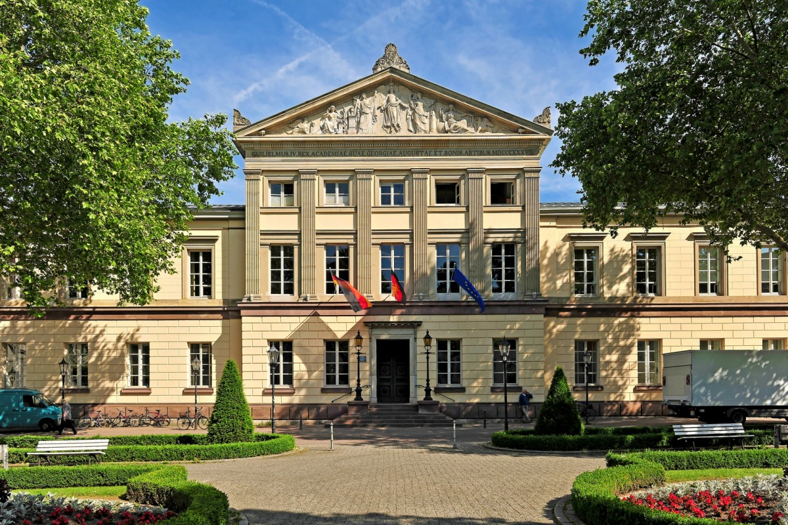

---
# This page uses ONLY Quarto Markdown, not nested HTML.
# Editing tip: headings begin with #, links use [text](destination),
# and the photograph uses standard Markdown image syntax.
# This avoids the HTML-as-code rendering problem visible in the screenshot.
title: "Jasmin Dönicke"
pagetitle: "Jasmin Dönicke | Population Health Science"
description: "Jasmin Dönicke: psychiatric epidemiology, global health and health inequalities. Population health science, research areas, collaborations and selected publications."
page-layout: article
---

Understanding health, beyond the individual.

I work at the intersection of psychiatric epidemiology, global health, and health inequalities. My research connects people's lives, the contexts they live in, and the methods we use to understand them.

Research Associate · Department of Medical Statistics · University Medical Center Göttingen

[**Explore my work ↓**](#research-areas)

{width="100%"}

*Great Hall of the University of Göttingen*

*People · Contexts · Methods — for a healthier world.*

---

## Different perspectives. A shared goal. {#population-health}

Population health science draws on clinical knowledge, public health, epidemiology, and quantitative methods to understand how health and its distribution are shaped across populations.

### Medicine

How can we diagnose, treat, and care for this patient?

### Public health

How can we prevent disease and protect communities?

### Epidemiology

On a population level, who experiences which health outcomes, when, and why?

### Biostatistics

How can we estimate patterns, effects, and uncertainty reliably?

**Population health science:** Bringing these perspectives together to understand population-level patterns, determinants, and inequalities in health. And inform ways to improve them.

---

## 3. Research Areas {#research-areas}

### 01 / PEOPLE

**Mental health across the life course**

Psychiatric and perinatal epidemiology, including longitudinal trajectories of mental health in youth.

### 02 / POPULATIONS

**A wider view of well-being**

Global health, disease burden, and the social and financial dimensions of well-being across countries.

### 03 / CONTEXT

**The conditions that shape health**

Social determinants, health inequality, and the epidemiological methods that help us ask better questions.

---

## 4. Collaboration Atlas {#collaboration-atlas}

### A global collaboration network

I have the privilege of working with incredible researchers around the world. Each dot represents a collaborator, colored by research project. Larger dots indicate more collaborations. Click a person or a region to explore our shared work.

[**Explore the atlas →**](atlas.html)

| 100+ | 30+ | 10+ |
|:---:|:---:|:---:|
| collaborators | countries | projects |

**Map legend**

- Mental health
- Global health & disease burden
- Child development
- Digital environments
- Methods & data science

[View full map →](atlas.html)

*The numbers above are estimates provided for the homepage. The interactive atlas is currently a curated subset, not yet the complete international collaboration network.*

---

## 5. Latest Work {#latest-work}

### July 2026 — Paper

**Risk factors associated with longitudinal trajectories of mania symptoms in youth**

*Development and Psychopathology*

PDF · [Details →](publications.html)

### July 2026 — Paper

**Global, regional, and national burden of exposure to chewing tobacco, 1990–2023**

*Lancet Global Health*

PDF · [Details →](publications.html)

### July 2026 — Paper

**A Multi-Lab Investigation of Neonatal and Early Imitation**

*Registered Report*

PDF · [Details →](publications.html)

### May 2026 — Paper

**Global mental wealth: A multidimensional analysis of social, financial, and emotional well-being in 92 countries**

—

PDF · [Details →](publications.html)

### February 2026 — Paper

**People in 26 countries prefer individual control to commercial or governmental control over online choice architectures**

—

PDF · [Details →](publications.html)

[**View all publications →**](publications.html)

*Links to public full-text PDFs have not yet been verified for every manuscript.*
