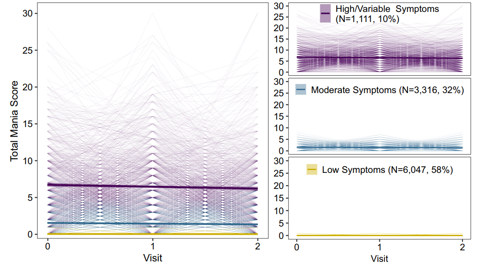
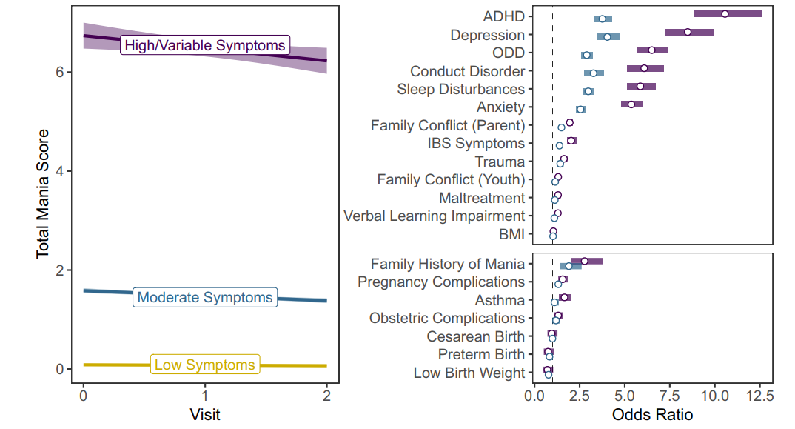

## Summary

What factors are associated with more severe mania-symptom trajectories in early adolescence? Using two years of longitudinal data from more than 10,000 participants in the Adolescent Brain Cognitive Development (ABCD) Study, we identified three trajectories: low symptoms (58%), moderate symptoms (32%), and high or variable symptoms (10%).

More severe trajectories were associated with depression, ADHD, anxiety, oppositional and conduct symptoms, sleep disturbances, irritable bowel syndrome symptoms, verbal-learning difficulties, trauma, and family conflict.

## Study at a glance

- **Population:** More than 10,000 young people who were aged 9–10 years at baseline
- **Study:** Adolescent Brain Cognitive Development (ABCD) Study
- **Follow-up:** Baseline, one-year follow-up, and two-year follow-up
- **Low-symptom trajectory:** 58%
- **Moderate-symptom trajectory:** 32%
- **High or variable trajectory:** 10%

## Topics

ABCD Study · pediatric mania · childhood and adolescent bipolar risk · latent growth mixture modelling · longitudinal psychiatric epidemiology

## Methods

Mania symptoms were measured at three annual assessments using the parent-reported 10-item Mania Scale from the Parent General Behavior Inventory (PGBI-10M).

Latent growth mixture models were used to identify groups of young people with different patterns of symptoms over time. Bias-adjusted multinomial logistic regression models then examined associations between trajectory membership and baseline factors covering mental health, physical health, cognition, family circumstances, and environmental experiences.

The association models accounted for sex, race, ethnicity, and socioeconomic status. False-discovery-rate correction was used to address multiple comparisons.

## Questions and answers

### What did the study investigate?

We investigated whether distinct patterns of mania symptoms could be identified during early adolescence and which mental, physical, cognitive, family, and environmental factors were associated with membership in those trajectories.

### Which symptom trajectories were identified?

Three groups were identified: a low-symptom group comprising 58% of participants, a moderate-symptom group comprising 32%, and a high or variable symptom group comprising 10%.

{fig-alt="Graphs showing mania-symptom scores at baseline, one-year follow-up, and two-year follow-up for three trajectory groups. The Low Symptoms group comprises 58 percent of participants and remains close to zero. The Moderate Symptoms group comprises 32 percent and shows moderately elevated scores that decrease slightly over time. The High or Variable Symptoms group comprises 10 percent and has substantially higher average scores, with considerable variation between participants and assessments." width="100%"}

*Figure 1. Mania-symptom trajectories across baseline, one-year follow-up, and two-year follow-up. Reproduced from Dönicke et al. (2026) under the [CC BY 4.0 licence](https://creativecommons.org/licenses/by/4.0/).*

Visit 0 represents baseline, Visit 1 the one-year follow-up, and Visit 2 the two-year follow-up. Thick lines show the mean score for each trajectory, shaded areas show 95% confidence intervals, and thin lines show individual participants’ scores.

The **Low Symptoms group** (*n* = 6,047; 58%) remained close to zero throughout the study. The **Moderate Symptoms group** (*n* = 3,316; 32%) had moderately elevated symptoms that decreased slightly over time. The **High/Variable Symptoms group** (*n* = 1,111; 10%) had much higher average scores, but also considerable individual variability: some participants had persistently elevated symptoms, whereas others experienced higher symptoms at only one or two assessments.

### Which factors were associated with more severe trajectories?

More severe trajectories were consistently associated with depression, ADHD, anxiety, oppositional and conduct symptoms, sleep disturbances, irritable bowel syndrome symptoms, verbal-learning difficulties, trauma, and parent- and youth-reported family conflict.

The findings suggest that understanding mania symptoms in young people may require looking across several areas of health and everyday life rather than considering psychiatric symptoms in isolation.

Let's have a closer look at the numbers!

Clear stepwise associations emerged across mental, physical, cognitive, and family factors. Compared with the Low Symptoms trajectory, membership in the High/Variable Symptoms trajectory was associated with:

- **Mental-health symptoms:** Symptoms of ADHD (aOR 10.56, 95% CI 8.85–12.62), depression (aOR 8.50, 95% CI 7.28–9.92), oppositional defiant symptoms (aOR 6.50, 95% CI 5.72–7.39), conduct symptoms (aOR 6.08, 95% CI 5.15–7.19), and anxiety (aOR 5.37, 95% CI 4.80–6.00).
- **Physical-health symptoms:** Sleep disturbances (aOR 5.86, 95% CI 5.13–6.70) and irritable bowel syndrome symptoms (aOR 2.03, 95% CI 1.79–2.31).
- **Cognitive factors:** Greater verbal-learning impairment (aOR 1.30, 95% CI 1.18–1.42).
- **Family and environmental factors:** Parent-reported family conflict (aOR 1.96, 95% CI 1.80–2.12), trauma (aOR 1.63, 95% CI 1.46–1.83), youth-reported family conflict (aOR 1.31, 95% CI 1.22–1.42), and a family history of mania (aOR 2.78, 95% CI 2.04–3.77).

The Moderate Symptoms trajectory generally fell between the other two groups. For example, compared with the Low Symptoms trajectory, adjusted odds ratios ranged from 2.55 to 4.04 for mental-health symptoms and were 2.98 (95% CI 2.72–3.26) for sleep disturbances.

All estimates were adjusted for sex, race, ethnicity, and socioeconomic status, and the associations reported above remained significant after false-discovery-rate correction (*p*~FDR~ < .001). Together, the results suggest that understanding mania symptoms in young people requires looking across several areas of health and everyday life rather than considering psychiatric symptoms in isolation. The associations concern trajectory membership and should not be interpreted as causal effects or bipolar-disorder diagnoses.

{fig-alt="Two-panel graph. The left panel shows mean mania-symptom scores at baseline, one-year follow-up, and two-year follow-up for three groups: High or Variable Symptoms, comprising 10 percent of participants; Moderate Symptoms, comprising 32 percent; and Low Symptoms, comprising 58 percent. The right panel shows adjusted odds ratios with 95 percent confidence intervals comparing the High or Variable and Moderate groups with the Low Symptoms group. The largest associations are observed for ADHD, depression, oppositional defiant symptoms, conduct symptoms, sleep disturbances, and anxiety." width="100%"}
*Figure 2. Associations between mania-symptom trajectories and risk factors. Models were adjusted for sex, race, ethnicity, and socioeconomic status. Reproduced from Dönicke et al. (2026) under the [CC BY 4.0 licence](https://creativecommons.org/licenses/by/4.0/).*

::: {.callout-note}
## How to interpret the odds ratios

In the right-hand panel, **purple represents the High/Variable Symptoms trajectory compared with the Low Symptoms trajectory**, while **blue represents the Moderate Symptoms trajectory compared with the Low Symptoms trajectory**. The horizontal bars show 95% confidence intervals. The dashed vertical line at an odds ratio of 1 indicates no association.

The predictors in the **upper panel are continuous measures that were z-standardized**. Their odds ratios therefore represent the change in the adjusted odds of trajectory membership associated with a **one-standard-deviation increase** in the predictor. For example, a one-standard-deviation increase in ADHD symptoms was associated with 10.56 times the odds of belonging to the High/Variable rather than the Low Symptoms trajectory (aOR 10.56, 95% CI 8.85–12.62).

The predictors in the **lower panel are binary variables**. Their odds ratios compare participants for whom the characteristic was present with participants for whom it was absent. For example, participants with a family history of mania had 2.78 times the odds of belonging to the High/Variable rather than the Low Symptoms trajectory compared with participants without a family history of mania (aOR 2.78, 95% CI 2.04–3.77).

These are differences in **odds**, not probabilities or causal effects. All models were adjusted for sex, race, ethnicity, and socioeconomic status.
:::

## Full citation

Dönicke, J., Cooper, R., Soehner, A., & Jalbrzikowski, M. (2026). Risk factors associated with longitudinal trajectories of mania symptoms in youth. *Development and Psychopathology*, 1–12. [https://doi.org/10.1017/S0954579426101606](https://doi.org/10.1017/S0954579426101606)

