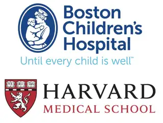

<!-- TIMELINE PAGE. The only shared styles are the existing site variables.
     Institutional image files: 3 existing local assets and 3 high-quality
     source logos fetched at build time into images/timeline/ (see publish.yml).
     Harvard Medical School wordmark is text until an approved logo is supplied.
-->

<main class="phs-timeline-redesign" id="timeline">
<header class="tl-hero">

TIMELINE

<h1>Research &amp; Training</h1>

My academic trajectory from psychology to epidemiology and biostatistics — combining clinical and methodological training to address mental health questions with rigorous, population-based research.

</header>

<section class="tl-entries" aria-label="Research and training milestones">
<article class="tl-entry">

UNIVERSITÄTS-MEDIZINGÖTTINGEN

<time class="tl-date" datetime="2026-09">2026 – present</time>

<h2>Research Associate / Biostatistician / Epidemiologist</h2>

University Medical Center Göttingen

Working Group: Statistical Evidence in AI Systems

▥ &nbsp; Biostatistics · Epidemiology · Health inequalities

</article>
<article class="tl-entry">

JOHANNES GUTENBERG UNIVERSITÄT MAINZ

<time class="tl-date" datetime="2025-10">2025 – present</time>

<h2>M.Sc. Epidemiology</h2>

Johannes Gutenberg University Mainz

In progress · Institute of Medical Biostatistics, Epidemiology and Informatics

</article>
<article class="tl-entry">

<time class="tl-date" datetime="2024-04">2024</time>

<h2>Visiting Researcher</h2>

Boston Children’s Hospital / Harvard Medical School

Neuroscience of Risk and Development Lab · Mania symptom trajectories in youth

<a class="tl-paper-link" href="https://www.cambridge.org/core/services/aop-cambridge-core/content/view/D13AAB6D0B35F78B38F00AFCA59C3929/S0954579426101606a.pdf/risk-factors-associated-with-longitudinal-trajectories-of-mania-symptoms-in-youth.pdf" target="_blank" rel="noopener noreferrer">▤ &nbsp; Related paper: Mania trajectories in youth ↗</a>

</article>
<article class="tl-entry">

<time class="tl-date" datetime="2024-08">2024</time>

<h2>Visiting Researcher</h2>

University of Cambridge · Policy Research Group

Online choice architectures across 26 countries

<a class="tl-paper-link" href="https://doi.org/10.31219/osf.io/haqu9" target="_blank" rel="noopener noreferrer">▤ &nbsp; Related paper: Online choice architectures ↗</a>

</article>
<article class="tl-entry">

<time class="tl-date" datetime="2022-07">2022</time>

<h2>Visiting Researcher</h2>

Toronto Metropolitan University

Addictions and Mental Health Lab · DAAD / Mitacs research award

</article>
<article class="tl-entry">

GEORG-AUGUST-UNIVERSITÄT GÖTTINGEN

<time class="tl-date" datetime="2022-10">2022 – 2025</time>

<h2>M.Sc. Clinical Psychology and Psychotherapy</h2>

University of Göttingen

Graduated May 2025

</article>
<article class="tl-entry">

GEORG-AUGUST-UNIVERSITÄT GÖTTINGEN

<time class="tl-date" datetime="2019-10">2019 – 2022</time>

<h2>B.Sc. Psychology</h2>

University of Göttingen

Graduated August 2022

</article>
</section>
<a class="tl-cv-link" href="https://www.linkedin.com/in/jasmindoenicke/" target="_blank" rel="noopener noreferrer">View full CV ↗</a>

<section class="tl-skills" aria-labelledby="tl-skills-title">

Skills

<h2 id="tl-skills-title">Methods, tools &amp; expertise</h2>

Selected skills and areas of expertise across statistical methods, data analysis, epidemiology, open science, and clinical research.

<button class="tl-skill-tab" type="button" role="tab" id="tl-tab-statistics" aria-controls="tl-panel-statistics" aria-selected="true" tabindex="0">Statistics &amp; Modeling</button>
<button class="tl-skill-tab" type="button" role="tab" id="tl-tab-programming" aria-controls="tl-panel-programming" aria-selected="false" tabindex="-1">Programming &amp; Data</button>
<button class="tl-skill-tab" type="button" role="tab" id="tl-tab-epidemiology" aria-controls="tl-panel-epidemiology" aria-selected="false" tabindex="-1">Epidemiology &amp; Causal Inference</button>
<button class="tl-skill-tab" type="button" role="tab" id="tl-tab-open" aria-controls="tl-panel-open" aria-selected="false" tabindex="-1">Open Science</button>
<button class="tl-skill-tab" type="button" role="tab" id="tl-tab-clinical" aria-controls="tl-panel-clinical" aria-selected="false" tabindex="-1">Clinical &amp; Domain Expertise</button>

▥

<h3>Statistics &amp; Modeling</h3>
Methods for clinical, longitudinal, and population-based research.

GLMM
Cox models
Kaplan–Meier
Longitudinal modeling
Multilevel regression
Latent variable models
MMRM
Survival analysis
Psychometrics

⌘

<h3>Programming &amp; Data</h3>
Computational tools for complex, reproducible analysis.

R / RStudio
Mplus
SAS
SPSS
MATLAB
Git &amp; GitHub
Quarto
Data visualization
Data pipelines

↗

<h3>Epidemiology &amp; Causal Inference</h3>
Study design, causal thinking, and population-level evidence.

Cohort studies
Causal DAGs
Propensity scores
Inverse probability weighting
Target trial emulation
Social epidemiology
Health inequalities
Observational data

◈

<h3>Open Science</h3>
Transparent workflows and collaborative research.

Preregistration
Open Science Framework
Reproducible research
Registered reports
Multi-lab collaborations
PRISMA
Code sharing
Documentation

♡

<h3>Clinical &amp; Domain Expertise</h3>
Clinical training paired with a population health perspective.

Clinical psychology
Psychotherapy (CBT)
Psychiatric epidemiology
Child &amp; adolescent mental health
Developmental psychopathology
Global mental health
Survey research
Mental health inequalities

</section>

</main>

